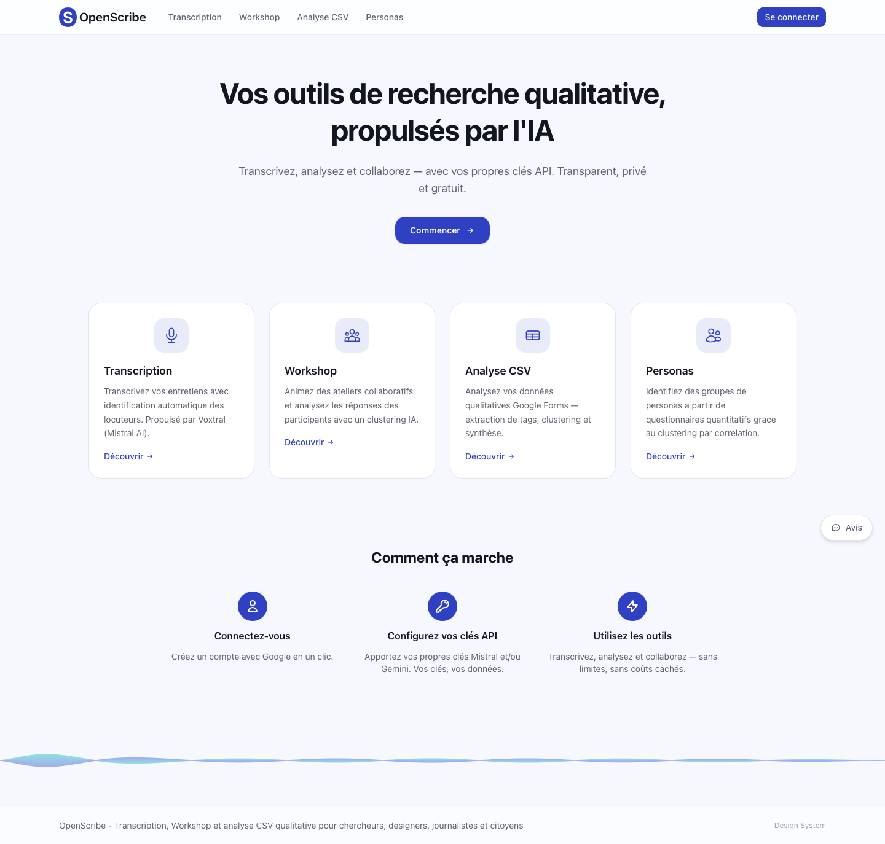

# OpenScribe — Product Blueprint & PRD

> Document de référence consolidant vision, architecture et état **réel** du code (mai 2026).
>
> Site live : [openscribe.fr](https://www.openscribe.fr/) · Repo : `github.com/Fasterious/openscribe` (privé)

---

## 1. Vision & mission

### Vision

Suite d'outils IA pour la **recherche qualitative et quantitative** : transcription longue durée, analyse de réponses ouvertes à l'échelle, personas fondés sur données questionnaire, ateliers collaboratifs avec clustering en direct.

### Mission

Donner aux UX researchers (et au-delà : journalistes, citoyens, associations) des workflows **explicites, traçables et BYOK** — chacun apporte ses clés Mistral et/ou Gemini.

### Valeurs

- **Transparence** : pipelines en étapes vérifiables dans l'UI, pas de boîte noire unique
- **Simplicité** : un module = un parcours clair
- **BYOK** : pas de financement centralisé des appels LLM par l'hébergeur
- **Open source** (objectif) : code visible ; monétisation / hébergement encore ouverts

---

## 2. Positionnement & modules produit

| Module | Route | Rôle | Moteur principal |
| --- | --- | --- | --- |
| **Transcription** | `/transcription` | Audio long, diarisation, export TXT/JSON | Voxtral (Mistral API) |
| **Analyse CSV** | `/csv-analysis`, `/csv-analysis/[analysisId]` | Réponses ouvertes Google Forms → clusters → synthèse | Gemini (extraction + clustering + synthèse) |
| **Personas** | `/persona`, `/persona/new`, `/persona/[analysisId]` | Clustering corrélations Likert → segments | TypeScript (`lib/persona/clustering.ts`) + LLM recommandation colonnes |
| **Workshop** | `/workshop`, `/workshop/create`, `/workshop/[sessionId]` | Atelier live, import réponses, nuage, clustering | Gemini / Mistral (`lib/llm/workshop-prompts.ts`) |

**Landing** (`/`) : hub des 4 modules + « Comment ça marche » (connexion Google, clés API, utilisation).

**Hors produit** : module « écriture d'histoires » expérimenté, non intégré.

### Concurrence (rappel)

Dovetail, Condens, Otter — différenciation : transcription longue, workflows research découpés, BYOK, multi-outils dans une app.

---

## 3. Architecture technique

### Stack

| Couche | Technologie |
| --- | --- |
| Framework | Next.js 16 (App Router) |
| Langage | TypeScript |
| UI | Tailwind v4, shadcn/ui, Radix |
| Auth | Supabase Auth (Google OAuth, Magic Link) |
| Transcription | Mistral Voxtral + Mistral Cloud / R2 pour gros fichiers |
| LLM analyse | Google Gemini + Mistral (selon module / choix utilisateur) |
| DB | Supabase (sessions workshop, csv-analysis, persona, métriques, clés API chiffrées) |
| i18n | Context React custom — FR, EN, ES, PT, DE |
| Deploy | Vercel (`maxDuration` 300s sur `/api/transcribe`) |

### Schéma logique

```
┌─────────────────────────────────────────────────────────────┐
│  Next.js (openscribe.fr)                                     │
│  Landing · Transcription · CSV · Persona · Workshop · Settings│
└───────────────────────────┬─────────────────────────────────┘
                            │
        ┌───────────────────┼───────────────────┐
        ▼                   ▼                   ▼
  Mistral Voxtral      Gemini / Mistral     Supabase
  (transcription)      (pipelines LLM)      (auth, sessions, BYOK)
```

### BYOK (Bring Your Own Key)

- Table `user_api_keys` (migration `20260401000000_create_user_api_keys.sql`)
- UI `/settings` — clés Mistral et Gemini par utilisateur
- Composant `require-api-key` : garde-fous avant analyse / transcription payante
- Pas de crédits centralisés opérationnels à date

---

## 4. Pipelines métier

### 4.1 Transcription

1. Upload (drag & drop) → `/api/upload` ou `/api/upload-url` (R2 si gros fichier)
2. `/api/transcribe` — appel Voxtral synchrone
3. Viewer locuteurs + métriques (durée, temps, coût estimé)
4. Preview tronquée possible non-auth ; cache `transcription-cache.ts` pour récupération post-login

**Limite prod** : timeout HTTP Vercel ~5 min sur transcriptions lourdes — pas de file async native documentée.

### 4.2 Analyse CSV (quali-quant)

Workflow en **5 étapes** (`lib/llm/csv-prompts.ts`) :

| Étape | Action | Appels LLM |
| --- | --- | --- |
| 1 | Parse CSV Google Forms | 0 |
| 2 | Extraction atomique — quintuplets (tag, verbatim, sentiment) | 1 / participant |
| 3 | Clustering global — normalisation tags | 1 global |
| 4 | Reconstruction traçabilité | code |
| 5 | Synthèse par cluster (comptages ✅⚠️💡 + verbatims) | 1 / cluster |

UI : `pipeline-stepper`, `cluster-view`, `final-report`, export MD/HTML.

Persistance : `csv_analysis_sessions` (+ migrations mars 2026).

**Preuve d'usage réel** : bilan campagne ÉcoSol (20 répondants, 304 verbatims, 8 thèmes) — hors repo, documenté dans vault portfolio Arnaud.

### 4.3 Personas (quantitatif)

1. Upload CSV → détection colonnes Likert (heuristique + `/api/persona/recommend-columns`)
2. Pré-calcul multi-*k*, matrices corrélation (`lib/persona/clustering.ts`)
3. Greedy grouping, subspace-cohesion, silhouette
4. Visualisations : heatmap, radar, légende interactive

**Validation** : jeu 50 répondants / 5 personas (fichiers de test externes au repo portfolio).

### 4.4 Workshop

1. Création session → question d'atelier
2. Réponses live ou import CSV/Excel/TXT (`import-modal`, `/api/workshop/import/structure`)
3. `/api/workshop/analyze` — clustering type CSV
4. Nuage de mots (layout déterministe, tooltips verbatims)
5. Realtime Supabase sur `workshop_responses`

**Données de test** : `supabase/seed_workshop_20_responses.sql`, `seed_workshop_100_responses.sql` (à exécuter sur une session existante).

---

## 5. Structure du code (état mai 2026)

```
openscribe/
├── app/
│   ├── page.tsx                      # Landing 4 modules
│   ├── transcription/page.tsx
│   ├── csv-analysis/
│   │   ├── page.tsx
│   │   └── [analysisId]/page.tsx
│   ├── persona/
│   │   ├── page.tsx
│   │   ├── new/page.tsx
│   │   └── [analysisId]/page.tsx
│   ├── workshop/
│   │   ├── page.tsx
│   │   ├── create/page.tsx
│   │   └── [sessionId]/page.tsx (+ participate)
│   ├── settings/page.tsx
│   ├── design-system/page.tsx
│   └── api/
│       ├── transcribe/, upload/, upload-url/
│       ├── csv-analysis/{extract,cluster,synthesize,sessions}
│       ├── persona/{sessions,recommend-columns}
│       ├── workshop/{sessions,responses,analyze,import}
│       ├── user/api-keys/
│       └── feedback/
├── components/
│   ├── transcription/, csv-analysis/, persona/, workshop/
│   ├── auth/, settings/, layout/, feedback/
│   └── ui/                           # shadcn
├── lib/
│   ├── llm/                          # csv-prompts, workshop-prompts, gemini, mistral
│   ├── persona/clustering.ts
│   ├── supabase/, i18n/, mistral.ts
│   └── transcription-cache.ts
├── supabase/migrations/              # workshop, csv_analysis, user_api_keys, metrics
├── scripts/
│   ├── capture-fullpage-stitch.mjs   # Screenshots scroll+stitch
│   ├── generate-pwa-icons.mjs
│   └── test-voxtral*.ts
└── docs/
    ├── METRICS_SETUP.md
    └── screenshots/                  # Captures marketing (stitch)
```

---

## 6. Modèle de données (Supabase)

| Domaine | Tables principales |
| --- | --- |
| Workshop | `workshop_sessions`, `workshop_responses`, `workshop_analyses` |
| CSV | `csv_analysis_sessions` (+ colonnes JSON résultats / étapes) |
| Persona | `persona_analysis_sessions` |
| Auth / BYOK | `user_api_keys` |
| Métriques | `transcription_metrics` (+ colonnes durée formatée) |

RLS activé sur les tables workshop ; policies par `auth.uid()`.

---

## 7. Captures d'écran & documentation visuelle

Les captures **marketing** (pages publiques déconnectées) sont dans `docs/screenshots/`, générées par :

```bash
npm run capture:screenshot -- --url https://www.openscribe.fr/ --out docs/screenshots/landing-stitch.png
```

Méthode : Playwright **`fullPage: true`** sur l’URL live (défaut) ; recollage manuel type GoFullPage en secours (`--method stitch`). Voir `docs/screenshots/README.md`.



| Module | Fichier |
| --- | --- |
| Landing | `landing.png` |
| Transcription | `transcription.png` |
| Analyse CSV | `csv-analysis.png` |
| Personas | `persona.png` |
| Workshop | `workshop.png` |

**À faire** (parcours connectés) : stepper CSV avec données, résultats clusters, session workshop avec seed SQL, persona après import CSV test — nécessite compte + clés API valides en local.

---

## 8. Roadmap (réaliste)

### Livré ✅ (mai 2026)

- [x] Landing multi-modules
- [x] Transcription Voxtral + BYOK Mistral
- [x] Module Analyse CSV complet (pipeline 5 étapes, export)
- [x] Module Persona (clustering TS, multi-k, viz)
- [x] Module Workshop (sessions, import, analyse, nuage)
- [x] Auth Supabase + page Settings clés API
- [x] i18n 5 langues
- [x] Feedback utilisateur
- [x] Script capture pleine page stitch

### En cours / pause

- [ ] Industrialisation transcription longue (batch async, hors limite 5 min Vercel)
- [ ] Persona : maturité UX et validation statistique externe
- [ ] Logo / identité visuelle satisfaisante
- [ ] Open source + modèle économique tranché

### Plus tard

- [ ] Bibliothèque transcriptions persistantes
- [ ] Stripe / crédits
- [ ] Résumé IA post-transcription
- [ ] Collaboration équipes

---

## 9. Variables d'environnement

```bash
# Mistral (Voxtral + cloud upload)
MISTRAL_API_KEY=

# Supabase
NEXT_PUBLIC_SUPABASE_URL=
NEXT_PUBLIC_SUPABASE_ANON_KEY=
SUPABASE_SERVICE_ROLE_KEY=    # métriques, admin

# Gemini (analyse CSV, workshop)
# Clés utilisateur stockées en DB — pas obligatoire en env global si BYOK only

# R2 (optionnel gros fichiers)
# Voir implémentation upload-url

NEXT_PUBLIC_APP_URL=https://www.openscribe.fr
```

Fichier local : `.env.local` (non versionné). Vérifier clés Gemini/Mistral dans `/settings` après connexion.

---

## 10. Décisions clés

| Décision | Choix | Raison |
| --- | --- | --- |
| Workflows LLM | Séquentiels (csv, workshop) | Qualité + traçabilité vs mega-prompt |
| Persona clustering | TypeScript pur | Auditabilité, pas de boîte noire |
| Transcription | Voxtral API | Qualité vs self-host RunPod (abandonné côté prod) |
| Auth | Supabase Google | Rapide, standard |
| LLM keys | BYOK utilisateur | Coût non supportable par l'hébergeur |
| Deploy | Vercel | DX Next.js ; contrainte durée fonctions |
| Captures doc | Playwright stitch | CDP fullPage dupliquait le viewport |

---

## 11. Ressources

- [README](./README.md)
- [Métriques](./docs/METRICS_SETUP.md)
- [Captures](./docs/screenshots/README.md)
- [Mistral Voxtral](https://docs.mistral.ai/capabilities/audio_transcription)
- Portfolio / case study : repo `Arnaud` → `vault/fr/04-openscribe/`

---

*Dernière révision : 21 mai 2026 — alignée sur le code `main` du repo OpenScribe.*
